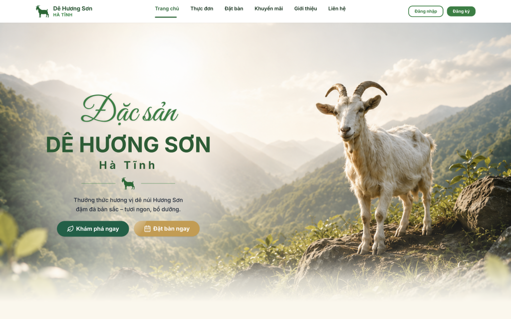
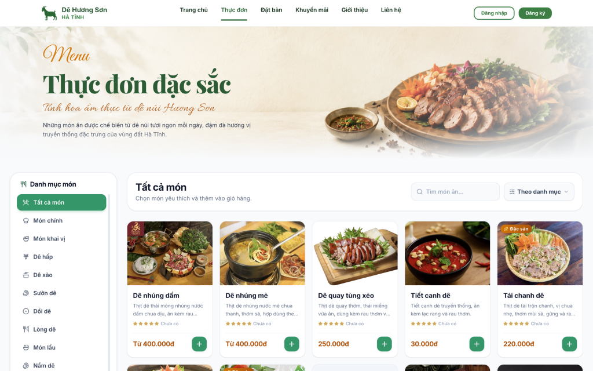
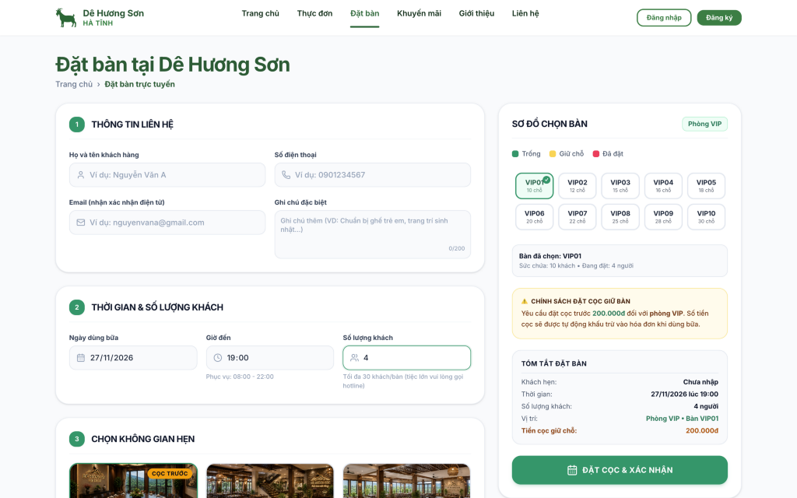

<div align="center">

# 🐐 HỆ THỐNG QUẢN LÝ NHÀ HÀNG DÊ HƯƠNG SƠN
### Restaurant Management & Smart Booking System

*Giải pháp chuyển đổi số toàn diện cho nhà hàng ăn uống, tích hợp đặt bàn thông minh, thực đơn trực tuyến, thanh toán VietQR và bảng điều khiển quản trị vận hành thời gian thực.*

[](https://dehuongson.vercel.app)
[](https://de-huong-son-api.onrender.com)
[](https://react.dev/)
[](https://nodejs.org/)
[](https://tidbcloud.com)
[](https://tailwindcss.com/)

---

[🌐 Trải nghiệm Website](https://dehuongson.vercel.app) • [📋 Thực đơn điện tử](https://dehuongson.vercel.app/menu) • [🪑 Đặt bàn trực quan](https://dehuongson.vercel.app/booking) • [⚙️ Bảng điều khiển Admin](https://dehuongson.vercel.app/admin/login)

</div>

---

## 📌 Giới Thiệu Dự Án (Project Overview)

**Dê Hương Sơn** là hệ thống phần mềm quản lý nhà hàng hiện đại được xây dựng theo mô hình **Full-stack Cloud Architecture** nhằm số hóa toàn bộ quy trình vận hành của nhà hàng ẩm thực:
1. **Khách hàng (Client Web Portal):** Khám phá thực đơn đặc sắc với 144+ món ăn, tìm kiếm & lọc đa tiêu chí, đặt bàn theo sơ đồ trực quan theo từng khu vực (Tầng 1, Tầng 2, Phòng VIP), đặt món trước (Pre-order) và thanh toán tự động qua mã VietQR Napas247.
2. **Vận hành & Quản trị (Admin BackOffice):** Giám sát trạng thái bàn ăn real-time qua Socket.IO, điều phối đặt bàn, quản lý quy trình chế biến & phục vụ, kiểm soát doanh thu - giá vốn - lợi nhuận và phân quyền nhân sự chi tiết theo vai trò (RBAC).

---

## 📸 Hình Ảnh Giao Diện Thực Tế (Screenshots)

### 1. Trang chủ & Giới thiệu đặc sản
*Giao diện sang trọng mang âm hưởng núi rừng Hương Sơn, giới thiệu món ăn tiêu biểu, ưu đãi và không gian ẩm thực.*


---

### 2. Thực đơn điện tử thông minh (19 danh mục - 144+ món)
*Tích hợp bộ lọc đa tầng, phân trang động, tìm kiếm thời gian thực và giỏ hàng tiện lợi.*


---

### 3. Đặt bàn trực quan theo khu vực & sơ đồ bàn ăn
*Quy trình đặt bàn 3 bước: Chọn thời gian -> Chọn không gian (Tầng 1, Tầng 2, Phòng VIP) -> Chọn bàn trực quan theo trạng thái thực tế kèm đặt cọc giữ chỗ.*


---

## ✨ Tính Năng Nổi Bật (Key Features)

### 🧑‍🍳 1. Phân Hệ Khách Hàng (Customer Portal)
* **Khám phá ẩm thực & Món ngon nổi bật:** Trưng bày các món ăn đặc sắc từ 100% dê núi thả tự nhiên (Tái chanh dê, Dê nướng tảng, Lẩu dê Hương Sơn...).
* **Thực đơn điện tử phân cấp:** Phân loại 19 nhóm món (Dê nướng, Dê hấp, Lẩu, Dồi dê, Hải sản, Đồ uống...), tìm kiếm tức thì, sắp xếp theo giá và độ phổ biến.
* **Đặt bàn thông minh (Smart Booking Flow):**
  * Tự động kiểm tra sức chứa bàn ăn theo ngày và khung giờ phục vụ (08:00 - 22:00).
  * Lựa chọn không gian trải nghiệm (Phòng VIP ấm cúng, Tầng 1 gần gũi, Tầng 2 thoáng mát).
  * Hiển thị trạng thái bàn trực quan: `Trống` (xanh), `Giữ chỗ` (vàng), `Đã đặt` (đỏ).
  * Chính sách đặt cọc phòng VIP tự động khấu trừ vào hóa đơn.
* **Giỏ hàng & Đa hình thức dùng bữa:** Hỗ trợ ăn tại chỗ (*Dine-in*), đặt mang về (*Takeaway*) và giao hàng (*Delivery*).
* **Cổng thanh toán VietQR & SePay Webhook:** Tự động sinh mã QR Napas kèm số tài khoản, số tiền và nội dung chuyển khoản chuẩn hóa (`DH...` cho đơn hàng, `DB...` cho tiền cọc); webhook tự động khớp trạng thái tức thì khi tài khoản nhận tiền.
* **Hệ thống Email tự động (Nodemailer):** Gửi email xác nhận đặt bàn, email duyệt đơn, email hủy và email nhắc hẹn tự động trước giờ dùng bữa 120 phút.
* **Quản lý tài khoản cá nhân:** Đăng ký/đăng nhập JWT, đăng nhập mạng xã hội (Firebase Google Auth), theo dõi lịch sử đơn hàng và phiếu đặt bàn.

---

### 💼 2. Phân Hệ Quản Trị & Vận Hành (Admin BackOffice)
* **Bảng điều khiển kinh doanh (Analytics Dashboard):** Thống kê số lượng đơn hàng, doanh thu thực tế, khách đặt trong ngày; biểu đồ phân tích cơ cấu bán hàng theo mốc thời gian (*Hôm nay, Hôm qua, 7 ngày, Tháng này, Năm nay*).
* **Sơ đồ bàn ăn trực quan (Visual Floor & Table Map):** Quản lý bàn theo từng tầng/không gian, đổi trạng thái bàn nhanh chóng, cấp mã PIN bảo mật cho từng bàn ăn.
* **Đồng bộ thời gian thực (Realtime Socket.IO):** Cập nhật trạng thái đơn hàng (`order_updated`), phiếu đặt bàn (`booking_updated`) và trạng thái bàn ăn (`table_updated`) giữa khách hàng và các bộ phận không cần tải lại trang.
* **Quản trị thực đơn toàn diện:** Thêm/sửa/xóa món ăn, cập nhật giá bán, giá vốn, danh mục phân cấp và upload hình ảnh.
* **Quản lý chương trình khuyến mãi (Deals & Vouchers):** Tạo mã giảm giá, giới hạn ngân sách ưu đãi, cài đặt thời gian bắt đầu/kết thúc và đồng hồ đếm ngược.
* **Phân quyền người dùng nghiêm ngặt (RBAC):** Hỗ trợ 7 cấp độ vai trò: `Admin`, `Manager`, `Staff`, `Cashier`, `Waiter`, `Chef`, `User`.
* **Nhật ký hệ thống (Audit Activity Logs):** Ghi lại toàn bộ hành vi chỉnh sửa, xếp bàn, cập nhật hóa đơn nhằm đảm bảo tính minh bạch.

---

## 🛠️ Công Nghệ Sử Dụng (Tech Stack)

| Lớp (Layer) | Công nghệ / Thư viện | Mô tả vai trò |
| :--- | :--- | :--- |
| **Frontend** | **React 19**, **Vite 8** | Giao diện Single Page Application (SPA), hiệu năng cao |
| **Styling** | **Tailwind CSS v4**, Lucide React, Glassmorphism | Thiết kế hiện đại, responsive đa kích thước màn hình |
| **Routing** | **React Router DOM v7** | Điều hướng phân trang, cấu hình Lazy Loading giảm 92.5% initial bundle |
| **Charts & Data** | **Recharts**, **XLSX-js-style** | Biểu đồ doanh thu trực quan, xuất báo cáo Excel chuyên nghiệp |
| **Backend** | **Node.js**, **Express 5** | Kiến trúc phân tầng Controller - Service - Pool chuẩn mực |
| **Realtime** | **Socket.IO v4** | Đồng bộ trạng thái đơn và sơ đồ bàn đa thiết bị tức thì |
| **Database** | **MySQL 8.4** & **TiDB Cloud** | Cơ sở dữ liệu quan hệ, kết nối SSL an toàn qua connection pool |
| **Authentication** | **JWT** & **Firebase Admin SDK** | Xác thực token bảo mật cao, hỗ trợ Social Login |
| **Email Service** | **Nodemailer** | Hệ thống template HTML email thông báo và nhắc lịch tự động |
| **Payment Gateway** | **VietQR** & **SePay Webhook** | Tự động sinh QR động và đối soát giao dịch chuyển khoản |
| **DevOps & Cloud** | **Docker**, **Vercel**, **Render** | Triển khai tách biệt Frontend - Backend - Database với chi phí tối ưu |

---

## 📐 Kiến Trúc Triển Khai Hệ Thống (Architecture)

```text
               +-------------------------------------------+
               |        NGƯỜI DÙNG / KHÁCH HÀNG & ADMIN   |
               +-------------------------------------------+
                                     |
                                     v
           +---------------------------------------------------+
           |    FRONTEND (Vercel): dehuongson.vercel.app       |
           |    - React 19 + Vite + Tailwind CSS v4            |
           |    - Client Portal & Admin BackOffice             |
           +---------------------------------------------------+
                        |                          ^
                        | HTTPS API REST           | Socket.IO Realtime
                        v                          |
           +---------------------------------------------------+
           |    BACKEND (Render): Node.js + Express 5          |
           |    - Auth (JWT, Firebase) & RBAC Authorization     |
           |    - Socket.IO Server & Background Cron Jobs       |
           |    - SePay Webhook & Nodemailer Service           |
           +---------------------------------------------------+
                        |                          |
           +------------+                          +-----------+
           v                                                   v
+-------------------------------+              +-------------------------------+
|  DATABASE (TiDB Serverless)   |              | DỊCH VỤ BÊN THỨ 3             |
|  - MySQL 8.4 Engine (Cloud)   |              | - VietQR / SePay (Thanh toán) |
|  - Bảng dữ liệu quan hệ & SSL |              | - Gmail SMTP (Gửi mail)       |
+-------------------------------+              +-------------------------------+
```

---

## 📂 Cấu Trúc Thư Mục (Directory Structure)

```bash
Restaurant-Management/
├── backend/                  # Mã nguồn máy chủ Node.js/Express
│   ├── src/
│   │   ├── config/           # Cấu hình DB pool, Firebase, Email, Socket
│   │   ├── controllers/      # Bộ điều khiển logic nghiệp vụ (Order, Booking, Menu, Table...)
│   │   ├── middleware/       # Xác thực JWT, phân quyền RBAC, upload Multer
│   │   ├── migrations/       # Quản lý phiên bản cấu trúc database
│   │   ├── routes/           # Định tuyến API RESTful
│   │   └── utils/            # Tiện ích tạo mã, format tiền tệ, helper
│   ├── uploads/              # Lưu trữ hình ảnh tải lên máy chủ
│   ├── server.js             # Điểm khởi chạy server chính
│   └── package.json
├── frontend/                 # Mã nguồn giao diện React/Vite
│   ├── src/
│   │   ├── assets/           # Hình ảnh, logo, tài nguyên tĩnh
│   │   ├── components/       # Các thành phần tái sử dụng (Header, Footer, Modals, Cards...)
│   │   ├── layouts/          # Khung trang MainLayout, AdminLayout
│   │   ├── pages/            # Các trang người dùng (Home, Menu, Booking, Cart...)
│   │   │   └── admin/        # Bảng điều khiển quản trị (Dashboard, Orders, Tables...)
│   │   ├── routes/           # Cấu hình AppRoutes & Route Guard bảo vệ
│   │   ├── services/         # Tầng gọi API Backend (Axios/Fetch)
│   │   └── utils/            # Bộ định dạng dữ liệu, helpers
│   ├── index.html
│   ├── vite.config.js
│   └── package.json
├── database/                 # Script khởi tạo cơ sở dữ liệu mẫu
│   └── init_schema_and_data.sql
├── docs/                     # Tài liệu thiết kế hệ thống, quy tắc & ảnh chụp
│   ├── screenshots/          # Hình ảnh giao diện thực tế của ứng dụng
│   └── DEPLOYMENT_GUIDE.md   # Hướng dẫn triển khai chi tiết lên Cloud
├── docker-compose.yml        # Thiết lập chạy MySQL 8.4 & phpMyAdmin cục bộ
├── start.sh                  # Kịch bản 1-click khởi chạy toàn bộ hệ thống
└── README.md
```

---

## 🚀 Hướng Dẫn Cài Đặt & Chạy Cục Bộ (Local Setup)

### 1. Yêu Cầu Môi Trường
* **Node.js** >= 18.x
* **NPM** hoặc **Yarn**
* **Docker & Docker Compose** (hoặc đã cài sẵn MySQL 8.0+ trên máy)

### 2. Tải Mã Nguồn Về Máy
```bash
git clone https://github.com/dinhphu-0124/Restaurant-Management.git
cd Restaurant-Management
```

### 3. Cấu Hình Biến Môi Trường (.env)

#### Backend (`backend/.env`):
```env
PORT=5001
NODE_ENV=development

# Cấu hình kết nối MySQL Docker (hoặc TiDB Cloud)
DB_HOST=127.0.0.1
DB_PORT=3306
DB_USER=root
DB_PASSWORD=rootpassword
DB_NAME=restaurant_db

# Bảo mật & Khóa JWT
JWT_SECRET=your_super_secret_jwt_key
JWT_EXPIRES_IN=7d

# Dịch vụ gửi Email (Gmail App Password)
EMAIL_USER=your_email@gmail.com
EMAIL_PASS=your_gmail_app_password

# Tích hợp SePay Webhook
SEPAY_API_KEY=your_sepay_api_key
```

#### Frontend (`frontend/.env`):
```env
VITE_API_URL=http://localhost:5001/api
VITE_SOCKET_URL=http://localhost:5001
```

### 4. Khởi Động Nhanh Với 1 Lệnh Duy Nhất (Recommended)
Dự án đã tích hợp sẵn kịch bản tự động hóa khởi động Docker, Backend và Frontend trong một cửa sổ:

```bash
chmod +x start.sh
./start.sh
```

Hệ thống sẽ tự động kích hoạt các dịch vụ tại:
* 🌐 **Website Khách hàng:** [http://localhost:5173](http://localhost:5173)
* 💼 **Trang Quản trị Admin:** [http://localhost:5173/admin/login](http://localhost:5173/admin/login)
* ⚙️ **Máy chủ API Backend:** [http://localhost:5001](http://localhost:5001)
* 🗄️ **Giao diện Quản lý Database (phpMyAdmin):** [http://localhost:8080](http://localhost:8080)

*(Hoặc bạn có thể chạy riêng lẻ từng dịch vụ bằng `npm run dev:backend` và `npm run dev:frontend`).*

---

## 👥 Danh Sách Tài Khoản Trải Nghiệm Mẫu

| Tài khoản | Tên đăng nhập / Email | Mật khẩu | Quyền hạn (Role) | Mô tả phạm vi truy cập |
| :--- | :--- | :--- | :--- | :--- |
| **Super Admin** | `admin` / `admin@dehuongson.vn` | `admin123` | `admin` | Toàn quyền quản trị hệ thống, báo cáo doanh thu, cấu hình |
| **Quản lý** | `manager@dehuongson.vn` | `manager123` | `manager` | Quản lý đặt bàn, điều phối sơ đồ bàn, duyệt menu & ưu đãi |
| **Thu ngân** | `cashier@dehuongson.vn` | `cashier123` | `cashier` | Quản lý hóa đơn, xác nhận thanh toán chuyển khoản & tiền mặt |
| **Khách hàng** | `khachhang@gmail.com` | `123456` | `user` | Đặt bàn, chọn món, lưu lịch sử và đánh giá món ăn |

---

## 🌐 Liên Kết Trực Tuyến & Thông Tin Liên Hệ

* **Website Trực Tiếp:** [https://dehuongson.vercel.app](https://dehuongson.vercel.app)
* **API Documentation & Health Check:** [https://de-huong-son-api.onrender.com/api/health](https://de-huong-son-api.onrender.com/api/health)
* **Kho lưu trữ GitHub:** [https://github.com/dinhphu-0124/Restaurant-Management](https://github.com/dinhphu-0124/Restaurant-Management)
* **Nhà Hàng Dê Hương Sơn - Đặc Sản Dê Núi:**
  * 📍 Địa chỉ: Đ. Vũ Lăng, Thanh Trì, Hà Nội
  * 📞 Hotline: 038 713 6878 / 076 877 4619
  * ✉️ Email: dehuongsonn.ht@gmail.com

---

<div align="center">
  <sub>Được phát triển với tâm huyết nhằm hiện đại hóa và nâng tầm trải nghiệm ẩm thực truyền thống Việt Nam. ⭐ Hãy nhấn Star cho dự án nếu bạn thấy hữu ích!</sub>
</div>
