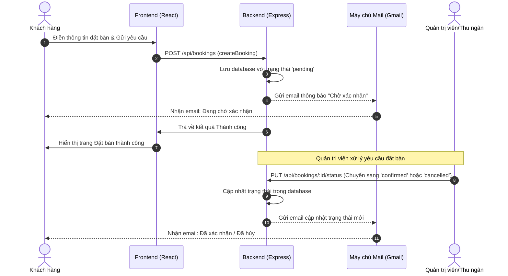

# 📖 HƯỚNG DẪN SỬ DỤNG CHỨC NĂNG ĐẶT BÀN & GỬI EMAIL TỰ ĐỘNG

Tài liệu này hướng dẫn chi tiết cách thức hoạt động, cấu hình và sử dụng luồng đặt bàn tự động có tích hợp gửi email thông báo trạng thái tại Nhà hàng Dê Hương Sơn.

---

## 1. ⚙️ Cấu hình Biến Môi Trường (Cho Lập trình viên / Quản trị hệ thống)

Để chức năng gửi email hoạt động ổn định qua **Nodemailer**, bạn cần khai báo các biến môi trường trong file `.env` ở thư mục `backend`:

```env
EMAIL_USER=your-email@gmail.com
EMAIL_PASS=xxxx xxxx xxxx xxxx
```

> [!IMPORTANT]
> - `EMAIL_USER`: Địa chỉ Gmail của nhà hàng sử dụng để gửi thông báo.
> - `EMAIL_PASS`: **Mật khẩu ứng dụng (App Password)** của tài khoản Google, không dùng mật khẩu Gmail thông thường. Để tạo, truy cập: *Tài khoản Google của bạn -> Bảo mật -> Xác minh 2 bước -> Mật khẩu ứng dụng*.

---

## 2. 🔄 Luồng Hoạt Động Của Hệ Thống (Workflow)



---

## 3. 👤 Giao Diện Khách Hàng (Customer Interface)

1. **Truy cập trang Đặt bàn:** Khách hàng vào menu "Đặt bàn" trên Website.
2. **Nhập thông tin:**
   - **Tên khách hàng, Số điện thoại, Email:** Thông tin liên hệ nhận vé.
   - **Ngày đặt, Giờ đặt, Số lượng khách:** Để hệ thống sắp xếp chỗ ngồi.
   - **Khu vực mong muốn:** Chọn Tầng 1, Tầng 2, Phòng VIP, Sân vườn,...
   - **Ghi chú:** (Ví dụ: Cần ghế trẻ em, tổ chức sinh nhật,...).
3. **Xác nhận đặt bàn:**
   - Sau khi nhấn "Đặt bàn", khách hàng sẽ nhận được màn hình thông báo Đặt bàn thành công.
   - Hệ thống tự động kích hoạt tiến trình gửi email. Khách hàng kiểm tra hòm thư để thấy email **"[Dê Hương Sơn] Thông báo đặt bàn [Mã đặt bàn] - Trạng thái: Đang chờ xác nhận"**.

---

## 4. 💼 Giao Diện Quản Trị / Thu Ngân (Admin Backoffice)

1. **Xem danh sách yêu cầu:** Quản trị viên truy cập trang **Lịch đặt bàn (Admin Bookings)** để xem danh sách các đơn đặt bàn mới ở trạng thái `Chờ xác nhận` (Màu vàng).
2. **Xác nhận hoặc Từ chối:**
   - **Xác nhận (Confirm):** Nhấp chọn bàn vật lý cụ thể (nếu có) và nhấn nút **Xác nhận**. Hệ thống chuyển trạng thái đặt bàn thành `Đã xác nhận` (Xanh lá) và tự động gửi email thông báo **"Đã xác nhận thành công"** kèm lời chào mừng gửi tới hòm thư khách hàng.
   - **Từ chối / Hủy (Cancel):** Nếu hết bàn hoặc khách yêu cầu hủy, chọn trạng thái **Đã hủy** (Đỏ). Khách hàng sẽ nhận được email thông báo **"Đã hủy"** kèm hướng dẫn liên hệ hotline nếu cần giải đáp.
